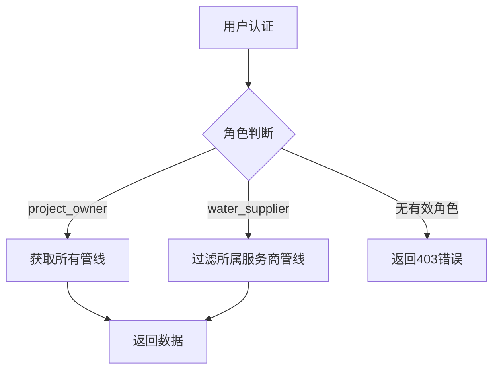

【开发笔记】Ubuntu 24.04+Odoo18+Vue配置前后端分离访问，测试通过！！
---

#### 联系作者： 微信号 odoo10   手机 18951631470  邮件 zou.jason@qq.com

---

### 管线数据接口详细文档  
**接口路径**：`/api/v1/pipelines`  
**请求方法**：`GET`, `POST`, `OPTIONS`  
**认证类型**：`Bearer Token`  
**CSRF保护**：禁用 (`csrf=False`)  

---

### 目录  
1. [GET 请求 - 获取管线列表](#1-get-请求---获取管线列表)  
   - [请求头](#11-请求头)  
   - [响应结构](#12-响应结构)  
   - [管线字段说明](#13-管线字段说明)  
   - [泵站字段说明](#14-泵站字段说明)  
   - [监控字段说明](#15-监控字段说明)  
2. [错误响应](#2-错误响应)  
3. [技术实现](#3-技术实现)  
   - [数据隔离逻辑](#31-数据隔离逻辑)  
   - [泵站数据处理](#32-泵站数据处理)  
4. [开发者指南](#4-开发者指南)  

---

### 1. GET 请求 - 获取管线列表  
#### 1.1 请求头  
| 参数名          | 必填 | 说明                | 示例值                  |  
|-----------------|------|---------------------|------------------------|  
| `Authorization` | 是   | Bearer + 会话ID     | `Bearer a1b2c3d4e5f6`  |  

#### 1.2 响应结构  
```json
{
  "status": 200,
  "msg": "成功",
  "count": 25,
  "data": [
    {
      "id": 101,
      "pipeline_no": "PL-2025-001",
      "display_name": "上海主干管线",
      "pipeline_diameter": 1200.0,
      "pipeline_length": 42.5,
      "pipe_update_status": "normal",
      "pump_stations": [
        {
          "id": 201,
          "name": "徐汇泵站",
          "latitude": 31.1956,
          "longitude": 121.4372,
          "monitoring": {
            "liquid_level": 8.2,
            "pressure": 150.3,
            "battery_level": 85.0
          }
        }
      ]
    }
  ]
}
```

#### 1.3 管线字段说明  
| 字段名                  | 类型    | 单位  | 说明                                                                 | 默认值 |  
|-------------------------|---------|-------|----------------------------------------------------------------------|--------|  
| `id`                    | int     | -     | 管线唯一ID                                                           | -      |  
| `pipeline_no`           | string  | -     | 管线编号（唯一标识）                                                 | ""     |  
| `display_name`          | string  | -     | 管线显示名称                                                         | ""     |  
| `pipeline_diameter`     | float   | mm    | 管线口径                                                             | 0.0    |  
| `pipeline_length`       | float   | km    | 管线总长度                                                           | 0.0    |  
| `pipe_update_status`    | string  | -     | 管线状态：<br>`normal`(正常)/`caution`(注意)/`alarm`(告警)           | "normal" |  
| `pipeline_activation_time` | string | -     | 启用时间（ISO 8601格式）                                             | null   |  
| `contact_phone`         | string  | -     | 联系电话                                                             | ""     |  
| `contact_person`        | string  | -     | 联系人姓名                                                           | ""     |  
| `partner_id`            | array   | -     | 服务商信息 `[ID, 名称]`                                              | [null, ""] |  
| `user_id`               | array   | -     | 负责人信息 `[ID, 姓名]`                                              | [null, ""] |  
| `monthly_traffic`       | float   | m³    | 当月流量                                                             | 0.0    |  
| `quarterly_traffic`     | float   | m³    | 当季流量                                                             | 0.0    |  
| `yearly_traffic`        | float   | m³    | 当年流量                                                             | 0.0    |  
| `total_traffic`         | float   | m³    | 总供水量                                                             | 0.0    |  
| `max_h2s_content`       | float   | ppm   | 历史最高H₂S含量                                                      | 0.0    |  
| `avg_h2s_content`       | float   | ppm   | 近30天平均H₂S含量                                                    | 0.0    |  
| `last_h2s_status`       | string  | -     | 最近H₂S监测状态                                                      | ""     |  
| `write_date`            | string  | -     | 最后更新时间（ISO 8601格式）                                         | null   |  
| `pump_station_count`    | int     | -     | 泵站数量（动态计算）                                                 | 0      |  
| `user_roles`            | array   | -     | 负责人角色：`project_owner`/`water_supplier`                         | []     |  

#### 1.4 泵站字段说明 (pump_stations)
| 字段名            | 类型    | 单位  | 说明                         | 默认值  |  
|-------------------|---------|-------|------------------------------|---------|  
| `id`              | int     | -     | 泵站唯一ID                   | -       |  
| `name`            | string  | -     | 泵站名称                     | ""      |  
| `latitude`        | float   | °     | 纬度坐标（WGS84）            | 0.0     |  
| `longitude`       | float   | °     | 经度坐标（WGS84）            | 0.0     |  
| `is_pump_station` | bool    | -     | 是否为泵站（true=是）        | false   |  
| `sequence`        | int     | -     | 在管线中的顺序位置           | 0       |  

#### 1.5 监控字段说明  (monitoring)
| 字段名               | 类型    | 单位  | 说明                                                                 | 默认值 |  
|----------------------|---------|-------|----------------------------------------------------------------------|--------|  
| `liquid_level`       | float   | m     | 当前液位高度                                                         | 0.0    |  
| `reservoir_depth`    | float   | m     | 当前蓄水池深度                                                       | 0.0    |  
| `reservoir_capacity` | float   | m³    | 蓄水池总容积                                                         | 0.0    |  
| `warning_level`      | float   | m     | 触发警告的液位阈值                                                   | 0.0    |  
| `alarm_level`        | float   | m     | 触发报警的液位阈值                                                   | 0.0    |  
| `pressure`           | float   | kPa   | 当前压力值                                                           | 0.0    |  
| `battery_level`      | float   | %     | 电池电量                                                             | 100.0  |  
| `distance`           | float   | km    | 与上一节点距离                                                       | 0.0    |  
| `length`             | float   | km    | 与起始点距离                                                         | 0.0    |  
| `status`             | string  | -     | 泵站状态：`normal`(正常)/`caution`(注意)/`alarm`(告警)               | "normal" |  
| `input_flow`         | float   | m³    | 实时输入流量                                                         | 0.0    |  
| `output_flow`        | float   | m³    | 实时输出流量                                                         | 0.0    |  
| `temperature`        | float   | ℃     | 温度                                                                 | 0.0    |  

---

### 2. 错误响应  
| HTTP状态码 | 错误原因                  | 响应示例                                  |  
|------------|--------------------------|------------------------------------------|  
| 400        | 参数缺失/格式错误         | `{"status":400,"msg":"缺少必要参数: pipeline_no","success":false}` |  
| 401        | 会话无效/过期             | `{"status":401,"msg":"需要身份验证","success":false}` |  
| 403        | 角色权限不足              | `{"status":403,"msg":"供水服务商无权创建管线","success":false}` |  
| 404        | 字段不存在                | `{"status":404,"msg":"字段pipeline_diameter不存在","success":false}` |  
| 500        | 系统内部错误              | `{"status":500,"msg":"管线创建失败","error":"...","success":false}` |  

---

### 3. 技术实现  
#### 3.1 数据隔离逻辑  


#### 3.2 泵站数据处理  
```python
def _process_pump_stations(pipeline):
    pump_stations = []
    for location in pipeline.locations:
        if location.is_pump_station:
            # 安全转换监控数据
            monitoring = {
                'liquid_level': float(location.liquid_level or 0.0),
                'pressure': float(location.pressure or 0.0),
                'battery_level': float(location.battery_level or 100.0)
            }
            pump_stations.append({
                'id': location.id,
                'name': location.name,
                'monitoring': monitoring
            })
    return pump_stations
```

---

### 4. 开发者指南  
1. **字段选择优化**  
   使用`fields`参数指定返回字段：  
   ```http
   GET /api/v1/pipelines?fields=id,pipeline_no,status,pump_stations.monitoring.pressure
   ```

2. **移动端集成示例**  
   ```javascript
   // 获取管线列表
   async function fetchPipelines() {
     const response = await fetch('/api/v1/pipelines', {
       headers: {'Authorization': `Bearer ${sessionId}`}
     });
     
     if(response.ok) {
       const data = await response.json();
       data.data.forEach(pipeline => {
         console.log(`管线 ${pipeline.pipeline_no} 状态: ${pipeline.pipe_update_status}`);
       });
     }
   }
   ```

3. **性能优化建议**  
   - 泵站监控数据每60秒刷新  
   - 管线基础数据每日凌晨缓存  

4. **监控指标**  
   | 指标                | 预警阈值  | 监控工具       |  
   |---------------------|----------|---------------|  
   | 平均响应时间        | >800ms   | Prometheus    |  
   | 数据一致性          | <95%     | Grafana       |  
   | 泵站数据缺失率      | >5%      | ELK日志       |  

> **坐标精度**：经纬度保留6位小数（≈0.1米精度）  
> **历史数据**：H₂S含量变化趋势保留180天
> 
> 
> 

======== 移动端集成示例 =========
```javascript
// 创建新管线
async function createPipeline() {
  const newPipeline = {
    pipeline_no: "PL-2025-100",
    display_name: "新建供水管线",
    pump_stations: [
      {latitude: 31.201, longitude: 121.442, is_pump_station: true}
    ]
  };
  
  const response = await fetch('/api/v1/pipelines', {
    method: 'POST',
    headers: {
      'Content-Type': 'application/json',
      'Authorization': `Bearer ${sessionId}`
    },
    body: JSON.stringify(newPipeline)
  });
  return response.json();
}
   ```