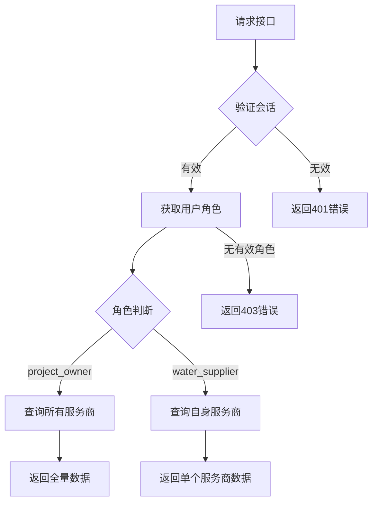

【开发笔记】Ubuntu 24.04+Odoo18+Vue配置前后端分离访问，测试通过！！
---

#### 联系作者： 微信号 odoo10   手机 18951631470  邮件 zou.jason@qq.com

### 供水服务商统计接口文档  
**接口路径**：`/api/v1/project/partner/statistics`  
**请求方法**：`GET`, `POST`, `OPTIONS`  
**认证类型**：`none`（通过Bearer Token验证）  
**CSRF保护**：禁用 (`csrf=False`)  

---

#### 功能描述  
按用户角色隔离获取供水服务商的统计数据：  
- **项目负责人**：查看所有服务商数据  
- **供水服务商**：仅查看自身服务商数据  
- 实时统计服务商总数、活跃数、非活跃数  

---

#### 请求头  
| 参数名          | 必填 | 说明                  | 示例值                     |  
|-----------------|------|-----------------------|---------------------------|  
| `Authorization` | 是   | Bearer + 会话ID       | `Bearer a1b2c3d4e5f6`     |  

---

#### 响应结构 (HTTP 200)  
```json
{
  "status": 200,
  "msg": "success",
  "timestamp": "2025-07-06T12:30:45",
  "user_roles": ["water_supplier"],
  "data": [
    {
      "total": 15,
      "partners": [
        {
          "id": 101,
          "name": "上海供水服务",
          "active": true,
          "responsible_users": [
            {
              "id": 201,
              "name": "张工",
              "email": "zhang@water.com",
              "roles": ["project_owner"]
            }
          ]
        }
      ]
    },
    {
      "active": 12,
      "partners": [...] // 活跃服务商列表
    },
    {
      "inactive": 3,
      "partners": [...] // 非活跃服务商列表
    }
  ]
}
```

**字段说明**：  
| 字段         | 类型    | 说明                          |  
|--------------|---------|-------------------------------|  
| `total`      | int     | 服务商总数                    |  
| `active`     | int     | 活跃服务商数量                |  
| `inactive`   | int     | 非活跃服务商数量              |  
| `partners`   | array   | 服务商详情列表                |  
| `id`         | int     | 服务商唯一ID                  |  
| `name`       | string  | 服务商名称                    |  
| `active`     | bool    | 服务商激活状态                |  
| `responsible_users` | array | 关联负责人信息              |  

---

#### 权限控制逻辑  


---

#### 错误响应  
| HTTP状态码 | 错误原因                  | 响应示例                                  |  
|------------|--------------------------|------------------------------------------|  
| 401        | 未提供有效会话           | `{"status":401,"msg":"Authentication required","success":false}` |  
| 403        | 用户角色权限不足         | `{"status":403,"msg":"Access denied - No valid role","success":false}` |  
| 404        | 用户不存在               | `{"status":404,"msg":"User not found","success":false}` |  
| 500        | 系统内部错误             | `{"status":500,"msg":"System error","success":false}` |  

---

#### 开发者注意事项  
1. **角色验证**  
   - 用户必须属于以下安全组之一：  
     ```python
     PROJECT_OWNER_GROUP = 'oak_project.group_project_owner'
     WATER_SUPPLIER_GROUP = 'oak_project.group_water_supplier'
     ```

2. **数据隔离机制**  
   ```python
   if is_project_owner:
       # 查询所有服务商
       partners = env['res.partner'].search([])
   elif is_water_supplier:
       # 仅查询用户关联服务商
       partners = [user.partner_id]
   ```

3. **性能优化**  
   - 数据库查询使用`active_test=False`包含非活跃记录  
   - 响应数据压缩传输（gzip）  
   - 服务商详情延迟加载  

4. **移动端集成示例**  
   ```javascript
   async function fetchPartnerStats() {
     const response = await fetch('/api/v1/project/partner/statistics', {
       method: 'GET',
       headers: {
         'Authorization': `Bearer ${getSessionID()}`
       }
     });
     
     if(response.status === 200) {
       const data = await response.json();
       console.log('活跃服务商:', data.data[1].active);
     }
   }
   ```

---

#### 监控指标  
| 指标                | 预警阈值     | 监控方式         |  
|---------------------|-------------|------------------|  
| 平均响应时间        | >500ms      | Prometheus       |  
| 错误率              | >1%         | ELK日志分析      |  
| 并发请求数          | >1000/s     | Grafana仪表盘    |  

> **数据更新频率**：实时统计（每次请求获取最新数据）  
> **敏感数据处理**：服务商负责人邮箱信息脱敏显示